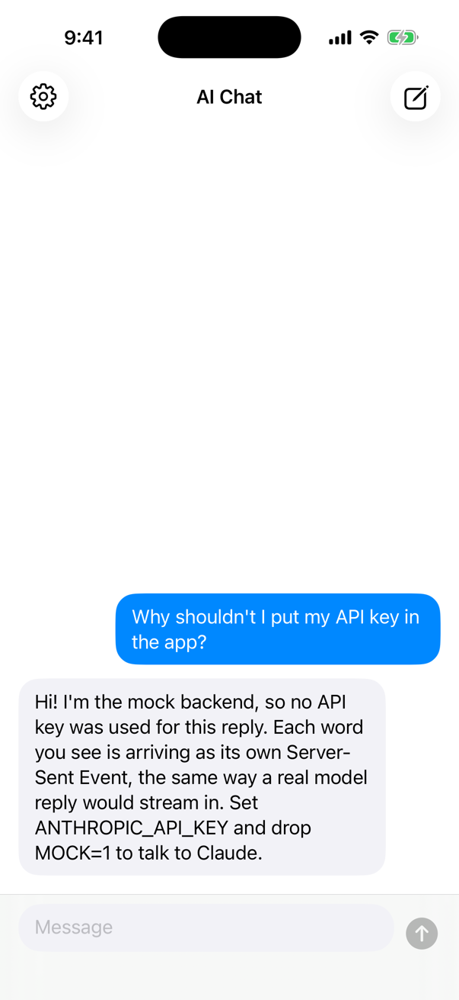
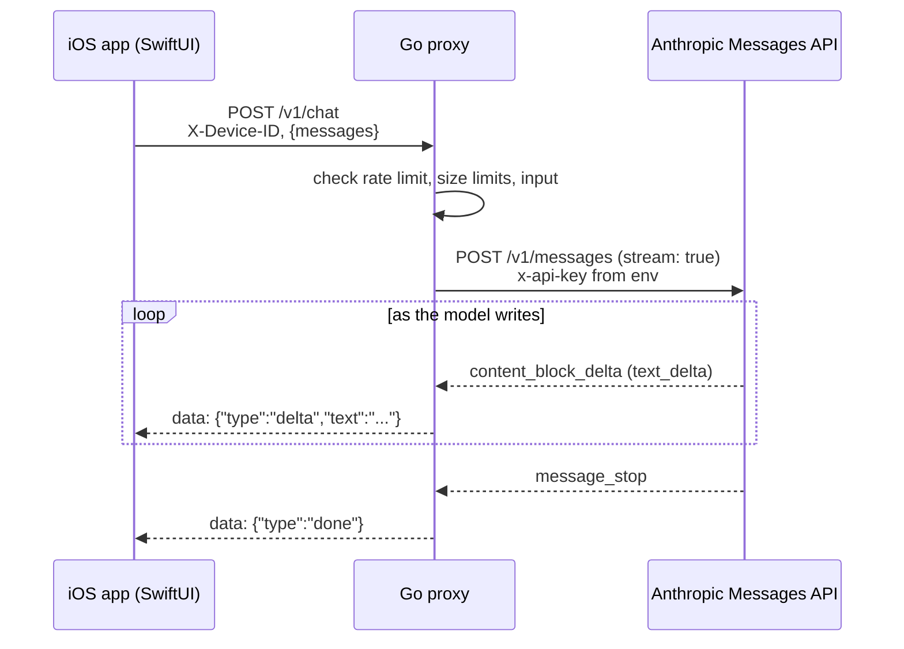

# swiftui-ai-chat

A small native iOS chat app that streams AI replies word by word, plus a tiny Go server that sits between the app and the model API.

If you only take one thing from this repo, make it this: don't ship your API key inside your app. Put a server in the middle. This project is the smallest version of that setup I could build while still doing it properly.

<p align="center">
  
</p>

## What this is

- **`ios/`** is a SwiftUI app (iOS 17+). You type a message, and the reply streams in as it's written. There's a stop button, an error banner with retry, Dynamic Type and VoiceOver support, and it follows light and dark mode.
- **`server/`** is a Go proxy with no dependencies outside the standard library. It holds the Anthropic API key, calls the Messages API with streaming turned on, and passes the text back to the app as Server-Sent Events.

The app never sees the key. It only knows the URL of your server.

## Why the proxy

It's tempting to call the model API straight from the app. It's one less thing to deploy. I'd still skip it, for a few reasons.

**Your key will leak.** Anything in an app bundle can be pulled out by someone with a jailbroken phone or a free afternoon. Obfuscation slows them down a little. Once your key is out, anyone can run up your bill, and the only fix is rotating it, which breaks every copy of the app that's already installed.

**You need rate limits you control.** The server here gives each install its own token bucket, keyed on a random device ID the app creates on first launch. That's enough to stop one runaway client from eating your quota. It isn't a security boundary (a determined person can send a fresh ID with every request), so if you have accounts, limit per user instead.

**You can change models without an App Store release.** The model ID, effort level, system prompt, and token limits all live in server environment variables. When a better or cheaper model comes out, you change one variable and restart. Nobody has to update the app, and you don't wait on review.

There's a cost question hiding in here too. If you're budgeting for an app like this, I wrote up [what goes into the price of an iOS app](https://bonniedoone.ai/blog/how-much-does-an-ios-app-cost).

## Architecture



If Mermaid doesn't render where you're reading this, the short version is:

```
iPhone app  --HTTPS, no key-->  Go proxy  --HTTPS + API key-->  Anthropic API
            <--SSE text chunks--          <--SSE events---------
```

## Quick start

You'll need Go 1.22 or newer and Xcode 16 or newer (I built it with Xcode 26).

### 1. Run the server in mock mode (no key needed)

```sh
cd server
MOCK=1 go run .
```

Mock mode streams a canned reply, so you can work on the app, run the tests, and demo it without spending anything. Try it from the terminal:

```sh
curl -N http://localhost:8080/v1/chat \
  -H 'X-Device-ID: my-test-device' \
  -d '{"messages":[{"role":"user","content":"Hello"}]}'
```

### 2. Run it with a real key

```sh
cd server
export ANTHROPIC_API_KEY=sk-ant-...
go run .
```

Or with Docker:

```sh
docker build -t swiftui-ai-chat-server server
docker run --rm -p 8080:8080 -e ANTHROPIC_API_KEY swiftui-ai-chat-server
```

The settings you're most likely to touch:

| Variable | Default | What it does |
| --- | --- | --- |
| `ANTHROPIC_API_KEY` | (required unless `MOCK=1`) | Your API key. Only the server ever sees it. |
| `ANTHROPIC_MODEL` | `claude-sonnet-5-5` | Which model to call. |
| `ANTHROPIC_EFFORT` | `low` | How hard the model thinks before answering. `low` keeps chat snappy. Try `medium` or `high` for harder questions. |
| `ANTHROPIC_MAX_TOKENS` | `16000` | Cap on reply length. |
| `ANTHROPIC_FALLBACKS` | on | For models that support it, asks the API to retry a declined request on a recommended fallback model. Set to `off` to disable. |
| `SYSTEM_PROMPT` | (none) | Optional instructions for the model. |
| `RATE_LIMIT_PER_MINUTE` / `RATE_LIMIT_BURST` | `10` / `5` | Token bucket per device ID. |
| `MAX_BODY_BYTES`, `MAX_MESSAGES`, `STREAM_TIMEOUT` | `65536`, `50`, `2m` | Request size and time limits. |
| `MOCK` | (off) | Set to `1` for the canned reply. |
| `PORT` | `8080` | Where to listen. |

There's also `GET /healthz` for your load balancer.

### 3. Run the app

Open `ios/ChatApp/ChatApp.xcodeproj` in Xcode, pick an iPhone simulator, and hit Run. The app talks to `http://localhost:8080` by default, which works from the Simulator because it shares your Mac's network. You can change the server URL under the gear icon.

Plain HTTP is allowed for `localhost` only, through an App Transport Security exception in `Info.plist`. Anything else needs HTTPS, which is what you want once the server is deployed. On a real device, `localhost` is the phone itself, so point the app at a deployed HTTPS URL instead.

## How streaming works

The server calls the Messages API with `"stream": true` and reads the Server-Sent Events as they arrive. Every time a `content_block_delta` with a `text_delta` comes in, it writes a small `data: {"type":"delta","text":"..."}` event to the app and flushes right away, so nothing sits in a buffer. On the phone, `ChatClient` opens the request with `URLSession.bytes(for:)`, splits the bytes into lines, and runs them through a tiny SSE parser that hands back each event's JSON. Those chunks come out of an `AsyncThrowingStream<String, Error>`, and the view model appends each one to the assistant's bubble on the main actor, which is what makes the text appear to type itself. Tapping Stop cancels the task, which closes the connection, and the server notices the disconnect and stops reading from the model.

## Project layout

```
.
├── server/                       Go proxy (module github.com/BonnieDooneConsulting/swiftui-ai-chat/server)
│   ├── main.go                   config from env, HTTP server, graceful shutdown
│   ├── internal/chat/
│   │   ├── handler.go            POST /v1/chat, GET /healthz, validation, SSE output
│   │   ├── anthropic.go          streaming Messages API client (plain net/http)
│   │   ├── mock.go               MOCK=1 canned reply
│   │   ├── ratelimit.go          per-device token bucket
│   │   └── handler_test.go       streaming order, 429s, 400s, timeouts
│   ├── Dockerfile
│   └── .golangci.yml
├── ios/
│   ├── ChatCore/                 Swift package with the logic, tested with `swift test`
│   │   ├── Sources/ChatCore/
│   │   │   ├── SSEParser.swift   line splitter and SSE parser
│   │   │   ├── ChatClient.swift  URLSession.bytes + AsyncThrowingStream
│   │   │   ├── ChatViewModel.swift  send, stop, retry, error state
│   │   │   ├── ChatMessage.swift
│   │   │   ├── ServerEvent.swift
│   │   │   └── DeviceID.swift    random per-install ID for X-Device-ID
│   │   └── Tests/ChatCoreTests/
│   └── ChatApp/                  the SwiftUI app
│       ├── ChatApp.xcodeproj
│       └── ChatApp/              views, settings, Info.plist
├── docs/screenshot.png
└── .github/workflows/ci.yml      Go vet/test/lint, swift test, xcodebuild
```

## Running the checks

```sh
# server
cd server && go vet ./... && go test ./... && golangci-lint run

# iOS
cd ios/ChatCore && swift test
cd ios/ChatApp && xcodebuild build -project ChatApp.xcodeproj -scheme ChatApp \
  -destination 'generic/platform=iOS Simulator' CODE_SIGNING_ALLOWED=NO
```

## What I left out on purpose

This is a teaching repo, so it stays small. A production version would want user accounts (and rate limits per user rather than per device), conversation history stored somewhere other than memory, and a shared rate limit store like Redis if you run more than one server. I'd also add App Attest or DeviceCheck so the server can tell it's talking to your real app. Each of those depends a lot on your app, which is why they aren't here.

## License

MIT. See [LICENSE](LICENSE).

---

Built by [Bonnie Doone Consulting](https://bonniedoone.ai). Building an iOS app with AI in it? [Let's talk](https://bonniedoone.ai/services/ios-app-development).
